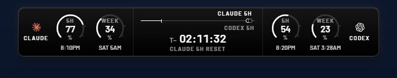
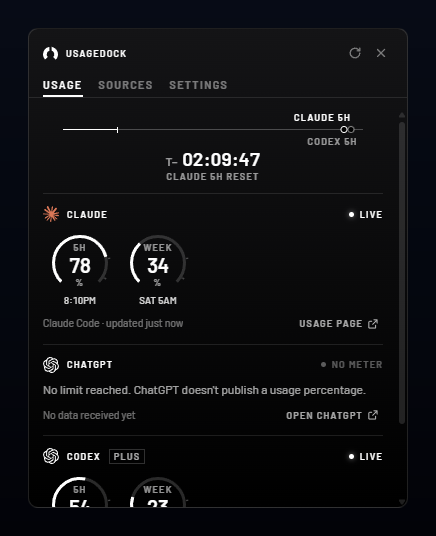
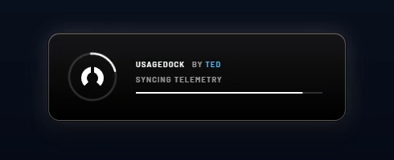
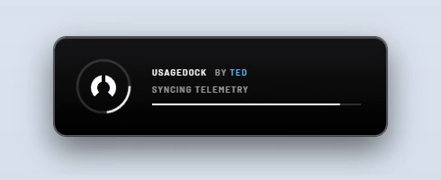

# UsageDock

A small Windows 11 desktop gadget that shows your AI plan usage (Claude, Codex, and ChatGPT where possible) from the system tray and a floating widget, without opening a browser tab.

<p align="center">
  
</p>

<p align="center">
  
</p>

| Dashboard | Launch splash |
| :---: | :---: |
|  | <br><br> |

*Screenshots are of the real app with real usage data.*

- **Tray icon**: left-click opens the dashboard next to the clock. Right-click opens a menu with Show dashboard, Compact widget, Always on top, Refresh, Settings and Quit. The tooltip shows the current percentages.
- **Compact widget**: a launch-telemetry style instrument panel. Each provider with data gets its mark and two dials: 5-hour and weekly, with ticks at your notification thresholds and a `T−` countdown to the reset. Dials are white, turning amber from 80% and red from 95%. The widget sizes itself to the providers that have data (two providers ≈ 165×170).
  - **Docking**: bottom-right by default. Pick any corner, edge centre or top/bottom centre in **Settings → Widget → Dock**, or drag the widget near one of those spots and it snaps there. Dropped elsewhere, it stays put ("free").
  - **Layout**: Auto stacks providers in corners and lines them up as a horizontal strip at top/bottom centre; you can force Stacked or Strip.
  - Collapse to numbers only with `–` (or double-click); hover for the controls. Always-on-top and opacity are in Settings.
- **Dashboard**: about 380×480, with Usage (every limit window, reset countdowns, source and age of each number), Sources (connect data sources) and Settings.

UsageDock never makes network requests. It reads small local files and shows only numbers it can verify.

## Install

Download `UsageDock_0.1.0_x64-setup.exe` from the [latest release](https://github.com/jasperdiaz/UsageDock/releases/latest) and run it.
(If you build it yourself, it's at `src-tauri\target\release\bundle\nsis\`.)
It installs per user, with no admin rights needed. WebView2 is already part of Windows 11.

Only one copy runs at a time. Launching it again brings the running copy forward.

## Connecting data sources

UsageDock starts with no data and says so ("Waiting for sync" / "Unavailable"). It never shows made-up numbers. Connect sources in **Dashboard → Sources**.

### Claude: Claude Code status line (recommended)

Claude Code passes documented `rate_limits` data to its status line command on Pro and Max plans: the 5-hour session and the 7-day window, each with `used_percentage` and `resets_at`. See the [status line docs](https://code.claude.com/docs/en/statusline). These limits are account-wide, so they also cover your use of claude.ai.

**Connect Claude Code** sets `statusLine` in `~/.claude/settings.json` to the bundled `usagedock-bridge.exe`:

- The file is backed up once to `settings.json.usagedock-backup`, and your other settings and key order are untouched.
- If you already had a status line, the bridge runs it and shows its output, so you lose nothing.
- The bridge writes only the two percentages and reset times to `%LOCALAPPDATA%\UsageDock\sources\claude-code.json`. Everything else Claude Code passes in is ignored.
- **Disconnect** restores your previous status line, or removes the setting if there was none.

Limitation: data refreshes while Claude Code is running. If you only use claude.ai, numbers go stale (they're shown with their age). Once a window's reset time passes, the old percentage is hidden and the window shows "Reset · waiting for sync".

### Claude, Codex and ChatGPT: browser extension (optional)

`extension/` is a Manifest V3 extension for Chrome or Edge:

1. In UsageDock go to **Sources → Set up bridge**. This registers the bridge as a native messaging host under `HKCU` and copies the extension to `%LOCALAPPDATA%\UsageDock\chrome-extension`.
2. Open `chrome://extensions` (or `edge://extensions`), turn on **Developer mode**, click **Load unpacked**, and pick that folder (**Open extension folder**).
3. That's it. While Chrome is open, the extension checks Claude's usage page every 15 minutes in a **minimized, unfocused window**, reads the numbers, and closes the window, so you don't need to keep a tab open. You can turn this off or click **Sync now** in the extension's popup. An open usage tab (`claude.ai/settings/usage`, which now opens as a settings dialog at `/new#settings/usage`) also syncs live.

The extension reads only the **visible text** of the usage page: percentages, labels and "Resets …" wording. It skips the "usage by product" breakdown, which shows shares rather than limits. It requests no host permissions and no cookie, history or web-request access, and calls no private APIs: it loads the same page you would open yourself. It sends data only to the local bridge, which validates it (known providers, allowed pages, 0–100%, sane reset times) before storing it. It adds model-specific Claude limits (for example "Weekly · Sonnet") when the page shows them.

The Codex web usage page (`chatgpt.com/codex/settings/usage`) currently redirects to the ChatGPT home page, so Codex numbers come from the Codex CLI logs (below).

Limitation: page layouts change. The parser matches text loosely, but a redesign can break it. If nothing is recognised, nothing is sent.

### Codex: automatic

The Codex CLI records the rate-limit status it gets with each turn in `~/.codex/sessions/…/rollout-*.jsonl`. UsageDock reads only the tail of the newest log and only the `rate_limits` object. It never opens `auth.json`. The data covers the 5-hour and weekly Codex windows and updates after each Codex turn.

### ChatGPT: limited by design

OpenAI doesn't publish a usage percentage or remaining-message count for ChatGPT plans, and the web app doesn't show one. UsageDock therefore shows ChatGPT as **Unavailable** rather than estimating. With the extension installed, it does record the "You've reached your … limit" notices ChatGPT shows, as *Limit reached* with the reset time when one is given. Notices without a reset time expire after 6 hours.

### Demo mode

**Settings → Demo mode** shows fixed sample values for trying the UI. A DEMO badge and banner always mark them, and notifications are off in demo mode.

## Settings

Start with Windows · show in system tray (with the tray off, closing the last window quits) · start in compact mode · always on top · show remaining instead of used · widget opacity · visible providers · reset window positions · re-scan interval · stale-data threshold · threshold notifications (pick from 50–100%; the default is 80/95/100) · notify when a limit resets.

Settings are saved to `%APPDATA%\com.usagedock.app\settings.json` and restored on start. Saved window positions are only reused if that spot is still on a connected monitor.

## Privacy

- No network requests. The app's content security policy blocks any outside connections from the UI.
- No passwords, cookies, session tokens or auth headers are read or stored. No private provider APIs are called.
- Everything UsageDock stores lives in `%LOCALAPPDATA%\UsageDock` (source snapshots, notification state) and `%APPDATA%\com.usagedock.app` (settings).

## How it works

```
Claude Code ──stdin JSON──▶ usagedock-bridge statusline ─┐
Chrome extension ─native messaging─▶ usagedock-bridge ───┼─▶ %LOCALAPPDATA%\UsageDock\sources\*.json
Codex CLI logs (~/.codex/sessions) ───────────────────────┼──────────────┐
                                                          ▼              ▼
                                  UsageDock sync thread: stat every 2 s, recompute on change,
                                  on the refresh interval, and every 30 s (resets/staleness)
                                                          │
                       tray tooltip · notifications · "usage://updated" event → widget + dashboard
```

| Path | Purpose |
| --- | --- |
| `src-tauri/src/providers/` | Provider adapters (`claude`, `codex`, `chatgpt`, `demo`). Each one turns local sources into a `ProviderSnapshot`. |
| `src-tauri/src/sync.rs` | Change detection and recompute loop, which emits events to the UI |
| `src-tauri/src/notify.rs` | Threshold and reset notifications, de-duplicated per window, persisted across restarts |
| `src-tauri/src/windows.rs` | Widget and dashboard windows, tray flyout positioning, multi-monitor/DPI-safe restore |
| `src-tauri/src/tray.rs` | Tray icon, menu and tooltip |
| `src-tauri/src/integrations.rs` | Claude Code status line connect/disconnect, native host registration |
| `bridge/` | `usagedock-bridge.exe`, a small helper with only `serde_json` as a dependency |
| `extension/` | Chrome/Edge companion extension |
| `src/` | React + Tailwind UI (`views/Widget.tsx`, `views/Dashboard.tsx`) |

### Adding a provider

1. Add `src-tauri/src/providers/<name>.rs` with `pub fn snapshot(ctx: &Ctx) -> ProviderSnapshot`. Read your source, then build windows with `finish_window` so stale and reset handling stays consistent.
2. Call it in `providers::collect`, and add its id to the defaults in `settings.rs`, to `PROVIDERS` in the bridge (if the extension feeds it), and to `ProviderIcon` / the colour tokens in `src/index.css`.

## Development

Prerequisites: Node 20+, Rust (stable, MSVC), Visual Studio Build Tools with the C++ workload, WebView2.

```powershell
npm install
npm run build:bridge      # once: builds the sidecar into src-tauri/binaries
npm run tauri dev         # run with hot reload
npm run test:rust         # unit tests (providers, settings, integrations)
npm run tauri build       # release exe + NSIS installer
```

`tauri dev` and `tauri build` keep their state in the same folders as the installed app.

## Known limitations

- Claude numbers depend on Claude Code running, or on the usage page being open with the extension. There is no supported way to fetch them in the background.
- ChatGPT has no usage meter, so UsageDock can only report limit notices.
- The extension's text parsing may need updates when provider pages are redesigned.
- The extension is loaded unpacked (Developer mode). Publishing it to the Chrome Web Store would remove that step.
- The installer is unsigned, so Windows SmartScreen may warn on first run.

## Future improvements

- Signed installer and auto-update (Tauri updater).
- Chrome Web Store / Edge Add-ons listing for the connector.
- Light theme and Windows accent-colour integration.
- Optional per-provider tray icons that show the current percentage.
- More providers (Gemini, Copilot, Cursor) where a verifiable local or documented source exists.
- Usage history sparkline from stored snapshots.
